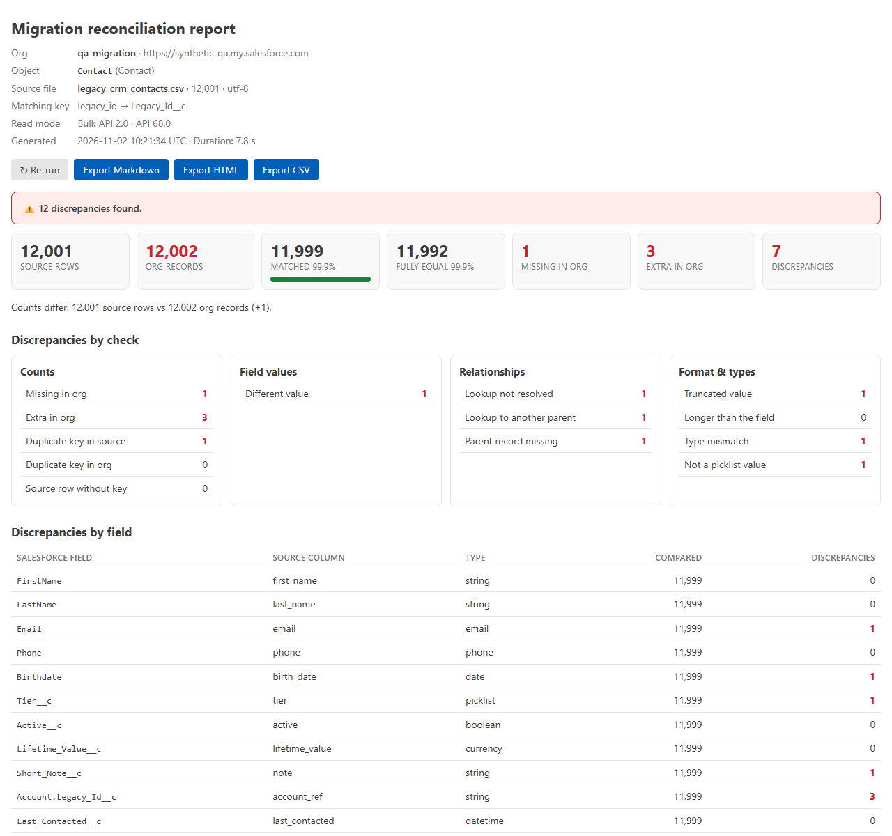
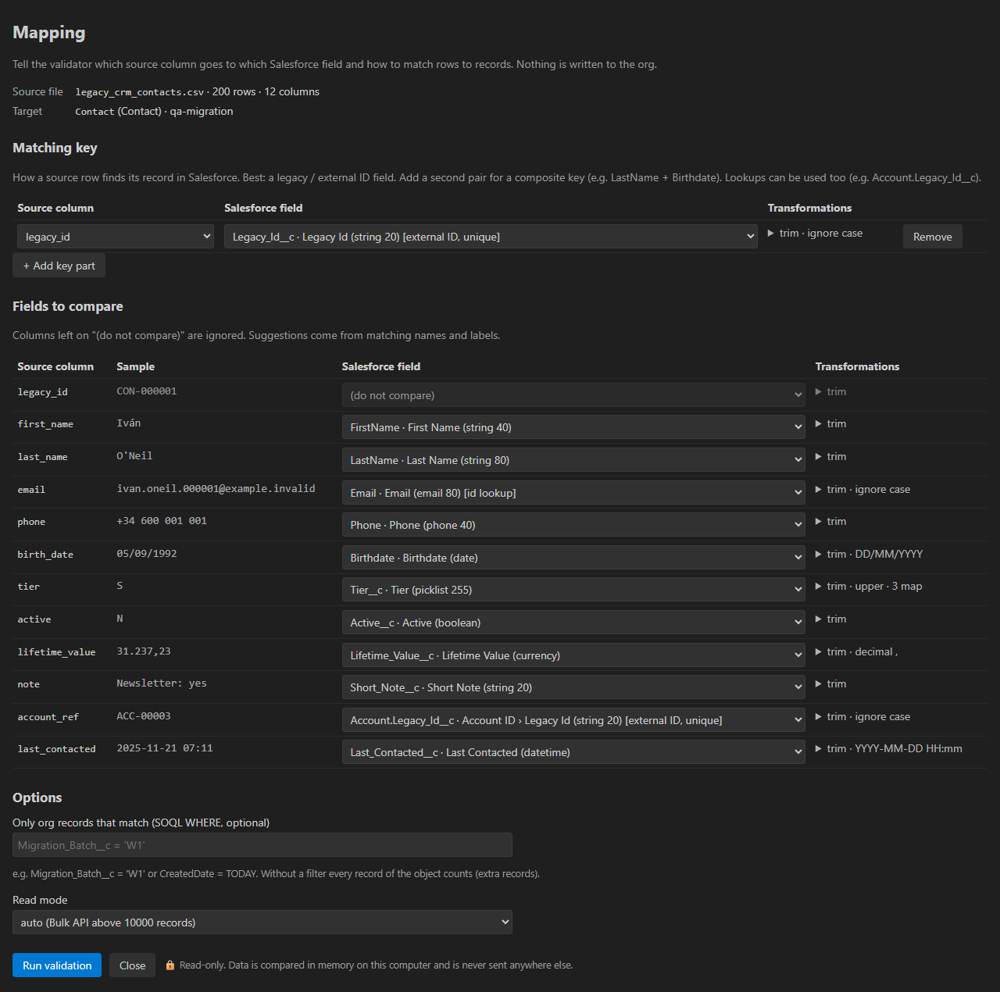
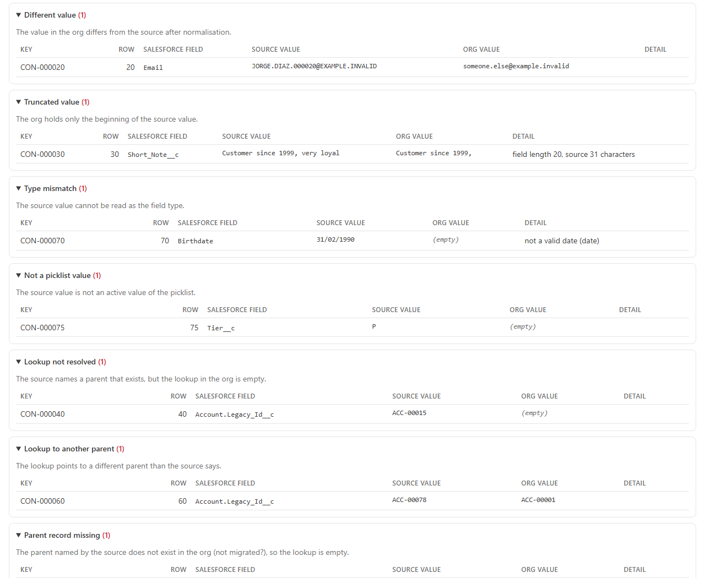

# Salesforce Migration Validator – Data Reconciliation for QA

**Did my Salesforce data migration land correctly?**

Migration tools (Data Loader, Jitterbit, Gearset…) **move** data — they don't **independently
prove** it arrived right. This extension reconciles your **source export (CSV)** against the
**target org**, field by field, and reports what's missing, extra, truncated, mismatched, or
has broken lookups.

**100% local · read-only · no backend · no telemetry.** Your migration data (often customer
PII) **never leaves your machine** — the only network call is to your own org via the Salesforce
CLI you already use.

Built by a Salesforce QA lead for the exact question every migration raises: *"has everything
migrated correctly?"*



## What it checks

- **Counts:** records that are missing (in the source but not in the org) and extra records.
- **Field by field** with normalisation (trim, upper/lower case, dates, numbers) → no false positives.
- **Truncation** and type mismatches.
- **Relationships:** lookups / master-detail resolve to an existing parent.
- **Exportable report** in Markdown / HTML / CSV to attach to the ticket. English and Spanish.

### Checks in detail

| Group | Checks |
|---|---|
| **Counts** | Source rows vs org records · **missing** in the org · **extra** in the org · duplicate keys (source and org) · rows without a key |
| **Field values** | **Field-by-field** comparison of every matched record, with type-aware **normalisation** so formatting differences don't show up as false positives |
| **Relationships** | Lookups / master-detail **resolve**: lookup left empty, lookup pointing to **another parent**, parent record **never migrated** |
| **Format & types** | **Truncated** values (org holds only the beginning), values longer than the field, values that can't be read as the field type (bad dates, numbers, booleans), values that aren't picklist values |

### Normalisation (no false positives)

| Source | Salesforce | Equal? |
|---|---|---|
| `  Ana ` | `Ana` | ✅ trim |
| `ANA@EXAMPLE.COM` | `ana@example.com` | ✅ ignore case |
| `02/11/2026` (`DD/MM/YYYY`) | `2026-11-02` | ✅ date format |
| `2026-11-02 11:30 +01:00` | `2026-11-02T10:30:00.000Z` | ✅ time zones |
| `1.234,50 €` | `1234.5` | ✅ decimal separator, currency, field scale |
| `Y` / `sí` / `1` | `true` | ✅ checkbox |
| `G` (map `G=Gold`) | `Gold` | ✅ picklist value map |
| `b;a` | `a;b` | ✅ multi-select order |
| `001A0000006Vm9r` | `001A0000006Vm9rIAC` | ✅ 15/18-char Ids |

## Privacy

No cloud. No account. No data upload. The extension runs entirely on your machine and only talks
to the org you're already authenticated against with the Salesforce CLI.

## The mapping editor

Pick the org, the object and the source file. The editor suggests a mapping from column names and
field labels, picks an **external ID** as the matching key, and guesses date formats and decimal
separators from your data. Adjust it in one screen:

- **Matching key**: one column (ideally a legacy / external ID) or a **composite key**. Lookups can
  be part of the key (e.g. `Account.Legacy_Id__c`).
- **Fields to compare**: source column → Salesforce field, or a parent field through a lookup
  (`Account.Legacy_Id__c`, `Owner.Username`).
- **Simple transformations** per field: trim, upper/lower case, ignore case, date format, decimal
  separator, value map (picklist codes, Y/N…).
- **Org filter** (optional SOQL `WHERE`) to scope the records of this migration wave, e.g.
  `Migration_Batch__c = 'W1'`.



## Volume: REST or Bulk API 2.0

Small objects are read with SOQL over REST. When the object holds more than `bulkThreshold`
records (10,000 by default) the extension uses a **Bulk API 2.0 query job** (one job, results
streamed in pages), after checking your daily limits. Verified with 12,000 records on a real
scratch org: ~8 seconds, 12 API requests.

## The report

- Verdict, tiles (source rows, org records, % matched, % fully equal, missing, extra), discrepancies
  **by check** and **by field**, and the detail of each discrepancy with the source and org values.
- **Export to Markdown, HTML or CSV** to attach to the migration ticket. The CSV has every
  discrepancy (one per line) and is protected against spreadsheet formula injection.
- English and Spanish.



## Getting started

1. Install the [Salesforce CLI](https://developer.salesforce.com/tools/salesforcecli) and sign in:
   ```sh
   sf org login web --alias target-org
   ```
2. In VS Code run **Migration Validator: Validate a migration (CSV vs org)** — from the Command
   Palette, the Migration Validator icon in the Activity Bar, or right-click a `.csv` file.
3. Choose the org, the object and the source file. Check the mapping and the key, then **Run
   validation**.
4. Read the report; export it with the buttons at the top. Fix, re-load, and **Re-run**.

Supported source files: `.csv`, `.tsv`, `.txt` (delimiter detected: `,` `;` tab `|`), and `.json`
(an array of objects, or `{ "records": [...] }`). UTF-8 or Windows-1252. Excel: save as *CSV UTF-8*.

## Security details

- **Read-only.** The extension only sends GET requests, plus the POST that creates a Bulk API *query*
  job. It never creates, updates or deletes records.
- **Your data stays here.** Source files and org records are compared in memory on your computer.
  Nothing is sent to any server of ours (there are none). Reports reach disk only when you export them.
- **No credentials stored.** The session comes from the Salesforce CLI (`sf org display`,
  `sf org auth show-access-token`), lives in memory for the run, and is never logged or written.
  The CLI's telemetry is turned off for the calls the extension makes.
- **Salesforce domains only.** The session is only sent to `*.salesforce.com`, `*.force.com` and the
  other Salesforce domains; any other host is refused and redirects are not followed.
- **No telemetry.** The log (**Migration Validator: Show log**) contains counts and timings, never
  record values.
- The extension remembers your last **mapping** per object in the workspace (column and field names,
  transformations) so re-runs are quick. It never stores record values.

## Settings

| Setting | Default | Description |
|---|---|---|
| `migrationValidator.cliPath` | *(empty)* | Path to `sf` if it isn't on your PATH (machine-level setting only) |
| `migrationValidator.language` | `auto` | `auto`, `en` or `es` |
| `migrationValidator.queryMode` | `auto` | `auto`, `rest` or `bulk` (can also be changed per run in the editor) |
| `migrationValidator.bulkThreshold` | `10000` | In `auto`, records from which Bulk API 2.0 is used |
| `migrationValidator.sourceEncoding` | `auto` | `auto` (UTF-8, falls back to Windows-1252), `utf8`, `windows1252` |
| `migrationValidator.sourceTimezone` | `utc` | Time zone of source date/times without offset: `utc` or `local` |
| `migrationValidator.maxIssuesStored` | `50000` | Discrepancies kept in the report (counts are always exact) |
| `migrationValidator.requestTimeoutSeconds` | `120` | Timeout per request |

## Tips and limits (v1)

- **The matching key matters most.** Best: an external ID / legacy id field in Salesforce. Without
  one, use a composite key (e.g. `Email` + `LastName`); keys must be unique on both sides or the
  report flags duplicates.
- **Use the org filter** if the object already had records before the migration; otherwise they show
  up as *extra*.
- One object per run and one relationship level (`Account.Legacy_Id__c`, not `Account.Owner.Name`).
- Compound fields (addresses, geolocation) are compared through their components
  (`MailingStreet`, `MailingCity`…).
- The whole source file is read into memory (up to 512 MB).

## Requirements

- VS Code 1.90 or later.
- Salesforce CLI (`sf`) with the target org authenticated, and a user with *API Enabled* and read
  access to the object and fields.

## More Salesforce QA tools

- **[Salesforce Org Parity – Config Diff for QA](https://marketplace.visualstudio.com/items?itemName=AndrsGarcaRamrez.org-parity-salesforce-qa)** — compare config/metadata between two orgs (sandbox vs prod).

## Español

**¿Se migró todo bien?** Compara tu export de origen (CSV o JSON) con los registros de la org y
obtén qué falta, qué sobra, qué valores difieren, qué se truncó y qué lookups quedaron rotos.
Solo lectura y 100% local: los datos de la migración (a menudo PII de clientes) no salen de tu
equipo. Interfaz e informe en español (sigue el idioma de VS Code o el ajuste
`migrationValidator.language`).

---

Salesforce is a trademark of Salesforce, Inc. This extension is not affiliated with or endorsed by
Salesforce, Inc.
